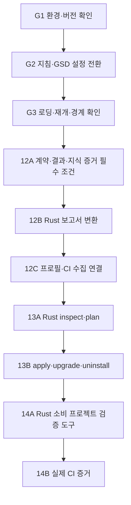

# GSD Core 전환 및 Task 12–14 실행 계획

> 실행자: 이 문서를 재개 지점으로 사용한다. 먼저 G 단계로 개발 워크플로를 GSD Core로 전환하고, 전환 완료를 확인한 뒤 Task 12 → 13 → 14를 진행한다. 이 계획을 실행하기 위해 Superpowers 스킬을 필수로 호출하지 않는다.
>
> 상태: **계획 작성 완료, 실행 미착수**. 이 문서 작성은 GSD 설치·활성화 또는 Task 12 구현 완료를 의미하지 않는다.

**목표:** GSD Core + Codex를 기본 개발 워크플로로 사용하고, Rust 기반 프로젝트 프로필·보고서 변환기·bootstrap을 구현하여 React/TypeScript, .NET 및 fullstack 소비 프로젝트에 적용한다.

**구조:** GSD는 계획과 개발 진행 상태를 관리한다. Codex가 구현하며 OpenCode 또는 Pi는 선택한 외부 리뷰/수정 실행기로 연결할 수 있다. 커널은 실행기와 무관한 계약을 통해 증거를 평가한다. CI와 GitHub가 authoritative 관측을 제공한다.

**기술:** 저장소 자체 실행 코드·테스트는 Rust 2021, 현재 고정 도구 체인은 `rust-toolchain.toml`의 Rust 1.95.0이다. 프로필과 설정은 JSON/YAML, 문서는 Markdown으로 작성한다. GSD와 소비 프로젝트의 Node/.NET 도구는 외부 실행 환경이다.

**설계 근거:**

- [추출 설계](../specs/2026-09-04-policy-kernel-extraction-design.md), 특히 §5–9와 §14–16.
- [프로필·bootstrap 설계](../specs/2026-09-07-project-verification-bootstrap-design.md).
- [기존 Task 12–14](2026-09-04-policy-kernel-implementation.md).
- [Task 8–11 통합 기록](../reviews/2026-09-08-main-integration.md).
- [Rust 검증 도구 전환 기록](../reviews/2026-09-08-rust-verification.md).

## 1. 재개 시 반드시 확인할 현재 상태

계획 작성 시 체크아웃은 `ab6cdf1`이며 작업 트리는 깨끗했다. Task 8–11은 이미 통합되었고, `4bca519`에서 기존 Python/Shell 검증 도구가 Rust `xtask`로 전환되었다. 예전 대화의 “Task 8–11 미통합”과 임시 워크트리 복구 순서를 다시 실행하지 않는다.

현재 완료 범위는 구현 통합이다. 다음은 별개의 미완료 릴리스 항목이다.

- 실제 정책·profile digest와 신뢰 가능한 CI 수집 경로를 사용한 운영 증거.
- 최종 후보에 대한 전체 mutation 결과와 독립 provider 리뷰.
- 보호 브랜치·shadow 표본·실제 rollback 증거.
- 통합 기록에 명시된 `deny.toml` 부재와 dependency/license 정책 확정.

이 항목들은 GSD 전환이나 Task 12의 정적 계약 작업을 막지 않는다. 실제 릴리스 또는 Task 14의 authoritative 실증에 필요한 항목은 해당 단계에서 충족해야 한다. 과거 GitHub HTTP 403 관측은 현재 계정 상태로 단정하지 말고 필요한 시점에 다시 조회한다.

읽기 전용 시작 명령:

```console
rtk git status --short
rtk git log -5 --oneline
rtk git worktree list
rtk proxy cat AGENTS.md rust-toolchain.toml
```

미커밋 변경이 생겨 있으면 보존하고 새 기준 head와 작업 위치를 기록한다. 기존 파일을 초기화하거나 예전 분기를 덮어쓰지 않는다.

## 2. 전체 공통 제약

1. `AGENTS.md`의 구현 언어 정책을 그대로 유지한다. 실행 로직, CLI, 검증 도구, 보고서 변환기, bootstrap 설치기와 저장소 테스트를 Rust로 작성한다. Python 및 새 Shell 구현을 추가하지 않는다.
2. Shell/YAML은 Rust 도구 호출과 CI 설정에 필요한 최소한만 사용한다. 워크플로 상태 검사나 보고서 분석은 Rust로 구현한다.
3. GSD를 Rust workspace 의존성으로 넣거나 upstream의 JS 실행 코드를 저장소에 복사하지 않는다. 외부 GSD 설치는 제품 bootstrap과 별도의 개발 환경 설정이다.
4. `.planning`은 개발 상태다. 커널 입력, 승인 증거, 운영 lifecycle 또는 GitHub merge receipt로 사용하지 않는다. `.planning`이 없어도 커널과 CI가 동작해야 한다.
5. provider/model/CLI 이름은 계약과 core의 필수 상수가 아니다. OpenCode/Pi 선택이 동일 provider의 자기 승인을 정당화하지 않는다. 모든 수정 기여자의 provider와 execution을 독립성 검사에 포함한다.
6. 로컬 결과는 advisory다. schema 검증, report normalization, GSD의 phase 완료가 `CiObserved` 또는 `SHIPPED`를 만들지 않는다.
7. 기존 증거를 재작성하거나 새 digest로 조용히 변환하지 않는다. 새 필수 필드 또는 digest 의미 변경은 명시적인 계약 버전 변경으로 다룬다.
8. 기존 Rust 릴리스 조건을 유지한다. GSD 검증 완화는 개발 반복 횟수에 적용하며 required sensor 누락 허용이나 CI 게이트 삭제로 구현하지 않는다.
9. 새 GSD 계획은 `docs/plans/`, 설계는 `docs/specs/`, 실행 요약은 `docs/reviews/`에 둔다. 기존 `docs/superpowers/` 문서는 과거 증거로 보존한다.
10. 이 계획의 명령은 미래 실행 절차다. 현재의 “테스트 실행 금지” 지시가 유지되는 동안 테스트·실제 소비 프로젝트 검증을 실행하지 않고 `not_run`으로 기록한다. 작성한 테스트와 통과한 테스트를 구별한다.
11. 원격 저장소 공개 전환, 결제 변경, 보호 설정 변경, 외부 코드 전송, 실제 merge는 계획 작성만으로 승인된 것으로 보지 않는다. 필요할 때 대상과 변경안을 먼저 구체화한다.

## 3. 단계와 선행 조건



Task 12는 기존 2·4·8·9를, Task 13은 12와 CI 템플릿을 위한 10을, Task 14는 10–13을 소비한다. Task 11은 전체 릴리스 근거를 담당한다. GSD phase 번호가 달라도 문서에 원래 Task ID를 유지한다.

## 4. GSD 전환 설계

### 선택한 방식

**저장소 지침과 활성 계획을 먼저 GSD로 전환하고, 외부 런타임에 공식 GSD 배포를 연결한다.** 기존 Superpowers 역사 문서를 삭제하거나 모든 문자열을 일괄 치환하지 않는다. 두 워크플로의 필수 검증을 동시에 실행하지 않는다.

Superpowers 설정만 완화하는 대안은 전환 비용이 작지만 사용자가 선택한 GSD 대상 변경을 충족하지 않는다. GSD 실행 코드를 커널에 통합하는 대안은 하니스 교체 가능성과 Rust 경계를 깨므로 사용하지 않는다.

개발 도구를 현재 계정 전체에서 제거하는 작업은 포함하지 않는다. `~/.codex`와 `~/.codex-f`를 혼동하지 않고 **현재 세션에 실제 적용되는 설치 경로**를 먼저 확인한다. 상위 호스트 지침이 계속 Superpowers를 주입하면 저장소 문서만 바꿔 해결됐다고 하지 않는다. 해당 로딩 설정을 지원되는 방식으로 조정하고 새 세션에서 확인한다.

### 가벼운 개발 검증 기본값

| 변경 | 개발 중 확인 | 최종 확인 |
| --- | --- | --- |
| Markdown·일반 설정 설명 | diff, 경로·링크·지침 충돌 정적 확인 | 문서 검토; 코드 테스트 없음 |
| 일반 Rust 기능 | 변경 동작의 관련 테스트 한 번 | PR 최종 head에서 workspace CI |
| 계약·hash·trust·승인 판단 | 구체적 부정/회귀 사례 + 영향받는 통합 경로 | 기존 릴리스 게이트 유지 |
| 보고서 변환·bootstrap 파일 처리 | 누락 보고서, 경로 이탈, 덮어쓰기 방지 등 관련 사례 | 단계 종료 시 관련 통합 검사 |

같은 head·설정·toolchain에서 성공한 동일 검증을 새 변경이나 실패 근거 없이 반복하지 않는다. 항상 별도 reviewer를 띄우거나 작은 단계마다 전체 workspace 검사를 하지 않는다. 중요한 동작 변경은 해당 회귀 사례를 유지한다. 전체 검증을 생략했다고 성공으로 기록하지 않는다.

GSD 설정의 **제안 overlay**는 아래와 같다. 설치할 고정 버전의 공식 설정 스키마/설명에서 각 키의 동작을 확인한 뒤 기존 설정에 병합한다. `false`가 실제 command 내부 검사까지 모두 제거한다고 추정하지 않는다.

```json
{
  "workflow": {
    "research": false,
    "plan_check": false,
    "verifier": false,
    "code_review": false,
    "tdd_mode": false,
    "auto_advance": false,
    "human_verify_mode": "end-of-phase"
  }
}
```

이는 자동 연구/검사 에이전트와 강제 TDD 반복을 줄이기 위한 기본값이다. 알려지지 않은 기술·계약 변경에는 필요한 연구와 사람의 결정을 수행한다. executor의 관련 확인과 CI 검증은 남는다. `auto_advance: false`는 phase가 자동으로 원격 Ship까지 진행하지 않도록 한다. `/gsd-ship`의 PR/merge 부작용을 확인하기 전 자동 호출하지 않는다.

## 5. G1 — 설치 대상과 버전 확정

**읽을 파일:** `AGENTS.md`, `README.md`, 현재 호스트가 제공하는 skill/plugin 목록, 기존 GSD 설정이 있으면 그 문서·설정만 읽는다. 인증 파일은 읽거나 복사하지 않는다.

**생성:** `docs/integrations/gsd-core.md`, `docs/reviews/2026-09-08-gsd-transition.md`.

- [ ] 현재 head, 실제 활성 Codex home, GSD 설치 유무, 사용 가능한 호출 이름을 기록한다. 위에서 읽은 과거 `.codex-f` 이력을 활성 환경으로 간주하지 않는다.
- [ ] 기존 GSD 설치가 있으면 버전과 실제 설정 지원 여부를 확인한다. 없으면 공식 배포의 고정 버전·소스 commit·배포 무결성 정보를 선택하여 문서에 기록한다. 설치 명령에 moving `latest`를 사용하지 않는다.
- [ ] 공식 installer의 해당 버전 help와 설치 경로를 확인하고 기존 사용자 설정과 충돌할 파일 목록을 만든다. 설치 결과를 만들기 위해 upstream agent 파일을 직접 복사하지 않는다.
- [ ] 제품 소스 안에 JS/Python 도구를 추가하지 않는 외부 설치 경로를 사용한다. 다른 계정의 인증·전역 도구를 변경하지 않는다.
- [ ] 외부 GSD 설치/호스트 로딩 조정을 수행할 때 변경 전 설정을 보존한다. 쓰기 승인이 필요한 경로라면 정확한 파일과 변경 내용을 제시한 뒤 플랫폼 승인 절차를 따른다.

**완료 조건:** 사용한 GSD 버전, 실제 설치 대상과 명령, overlay 지원 여부를 문서에서 재현할 수 있다. 설치 불가 시 G2의 문서 작업은 가능하지만 G3 완료로 진행하지 않는다.

## 6. G2 — 활성 작업 지침과 계획 연결

**수정:** `AGENTS.md`, `README.md`, `docs/plans/2026-09-04-policy-kernel-implementation.md`, `docs/specs/2026-09-07-project-verification-bootstrap-design.md`.

**생성/관리:** `docs/integrations/gsd-core.md`, GSD가 생성하는 `.planning/PROJECT.md`, `.planning/ROADMAP.md`, `.planning/STATE.md`, `.planning/config.json`.

- [ ] `AGENTS.md`의 Rust 언어 정책과 RTK 참조를 유지하고, 활성 설계·계획·구현 워크플로는 GSD Core라는 지침을 추가한다. 기존 승인 커널과 개발 상태를 구분한다.
- [ ] `AGENTS.md`에 §4의 개발 검증 범위를 명시한다. Superpowers의 TDD·계획 검사·반복 리뷰를 이 repo의 필수 절차로 중복 적용하지 않는다고 기록한다.
- [ ] 기존 전체 구현 계획의 Superpowers 필수 실행 헤더를 GSD 대상 지침과 이 문서 링크로 변경한다. 완료된 Task 1–11과 리뷰 원문은 보존한다. 역사 문서의 지시는 새 작업을 강제하지 않는다고 설명한다.
- [ ] `README.md`에 GSD 작업 시작/재개 문서와 이 계획 링크를 추가한다. kernel이 GSD에 의존한다는 설명은 추가하지 않는다.
- [ ] GSD의 기존 프로젝트 온보딩 기능을 사용하되 통합된 Task 1–11을 다시 구현하는 로드맵을 생성하지 않는다. G 단계와 12A–14B를 현재 로드맵에 연결한다.
- [ ] `.planning`에는 계획·상태·비밀 없는 설정만 둔다. 생성될 실행 코드/캐시/credentials는 저장소에 추가하지 않는다. `.planning`을 운영 산출물에 포함하지 않는다.
- [ ] §4 overlay를 실제 키별로 병합하고 지원되지 않는 키는 성공으로 취급하지 않는다. 버전별 대응 방법을 문서에 적는다.
- [ ] OpenCode/Pi는 선택형 실행기로 문서화한다. 미선택 상태에서 하나를 설치하거나 유료 리뷰를 실행하지 않는다. 현재 단계 완료를 두 도구의 설치에 의존시키지 않는다.

**완료 조건:** 활성 진입 문서는 GSD 하나로 연결되고, 역사 기록은 유지된다. Rust 정책·advisory/authoritative 경계·가벼운 검증 범위가 모순 없이 문서화된다.

## 7. G3 — 전환 완료 확인과 Task 12 진입

**수정:** `docs/reviews/2026-09-08-gsd-transition.md`, GSD의 실제 생성 상태 파일.

- [ ] 새 세션에서 고정한 GSD 명령/스킬이 실제로 로드되는지 확인한다. 문서에 명령 이름이 있다는 사실만으로 활성화를 판정하지 않는다.
- [ ] GSD의 read-only 진행 조회·재개 경로로 다음 작업이 `12A`임을 확인한다. 이 확인을 위해 코드 편집, 테스트, provider 리뷰 또는 Ship을 실행하지 않는다.
- [ ] `.planning` 문서만으로 ready/shipped 증거를 생성하는 경로가 없는지 정적으로 확인한다. `xtask/src/verification.rs`의 production residue 금지 규칙은 제거하지 않는다. 현재 검사는 `crates/*/src`, `schemas`, `action`, `Cargo.toml`을 대상으로 하므로 개발 상태와 분리할 수 있다.
- [ ] 활성 문서에서 필수 Superpowers 지시를 제거했는지 검색한다. `docs/superpowers/` 등 역사 문서의 단순 언급은 허용하고 결과에 구분하여 적는다.
- [ ] 전환 전후 설정, 미지원 기능, 다음 phase와 남은 운영 조건을 기록한다. 호스트의 강제 지침이 남으면 전환 상태를 `partial`로 적고 GSD 단독 실행으로 가장하지 않는다.

**검증:** 문서 변경은 `rtk git diff --check`와 내용 검토만 한다. 코드 scanner를 변경하지 않았다면 새 테스트를 추가하지 않는다.

**진입 조건:** G1–G3가 완료된 뒤 Task 12 구현을 시작한다. 설치/로딩이 막혀도 계약 분석은 문서로 진행할 수 있지만 “GSD 전환 완료”로 표기하지 않는다.

## 8. 12A — 프로젝트 검증 계약과 필수 보고서·지식 증거 누락 차단

**선행:** G3, Task 2·4·8·9.

**생성:** `docs/specs/2026-09-08-project-verification-contract.md`, `crates/policy-contracts/src/project.rs`, `schemas/project-profile.schema.json`, `crates/policy-core/src/knowledge.rs`, `crates/policy-core/tests/project_requirements.rs`, `crates/policy-core/tests/knowledge_requirements.rs`.

**수정:** `policy-contracts`의 `policy.rs`, `evidence.rs`, `lib.rs`; `policy-core`의 `sensors.rs`, `pre_merge.rs`, `provenance.rs`, `pre_merge_digest.rs`; `xtask` schema 생성/검사; 영향받는 CLI/CI/fixture.

**계약 입력/출력:** 프로젝트 프로필은 기존 `SensorProfile`과 실행 정의를 연결한다. `ProjectVerificationProfile`은 독립적인 profile version, 지원 evidence contract version, sensor profile, 센서별 실행 정의를 가진다. 실행 정의는 sensor ID, component 상대 경로, 명시 argv, tool version, lock/config digest, report format/path, parser version, timeout/output limit를 가진다. 프로필은 실행 주체나 provider를 선택하지 않는다.

- [ ] 위 파일에 정확한 wire 필드, canonical digest 범위, 각 오류의 non-success 분류를 먼저 확정한다. 해당 명세는 다음 하위 작업들의 입력이다.
- [ ] `SensorDefinition`에 정책으로 고정되는 결과 요구 사항을 도입한다: 실행 종료만 필요한 검사와 **테스트 보고서·개수가 반드시 필요한 검사**를 구별한다. 테스트 센서는 count 세 필드가 모두 없으면 통과할 수 없다.
- [ ] 실행 정의의 digest를 sensor profile/정책 digest에 연결한다. evidence에 기록된 argv·cwd·version·config·report format이 기대 정의와 일치해야 한다. 보고서의 자기 주장만 검증하지 않는다.
- [ ] 필수 필드와 digest 의미 변경을 새 evidence contract version으로 반영한다. 현재 v1 bytes/digest는 보존한다. 구버전 inspect 호환과 새 프로필의 authoritative 허용 범위를 명시하고 fixture로 구분한다. 새 필드를 default로 무시하는 우회는 금지한다.
- [ ] 원본 보고서의 byte digest와 정규화된 결과 digest를 구별한다. child artifact 목록과 보고서 참조를 함께 검증하도록 manifest/bundle 관계를 정의한다.
- [ ] 한 센서의 count와 adequacy의 test ID를 연결한다. `frontend/`, `backend/`, `shared/` namespace로 다른 component의 성공이 누락된 suite를 대신하지 못하게 한다. negative case 역시 실제 실행 test ID와 연결한다.
- [ ] 변경 영향이 unknown인 경우를 known empty path와 구별한다. unknown이면 전체 applicable profile을 선택하도록 통합 입력과 처리 규칙을 만든다.
- [ ] 아래 지식 증거 요구 사항을 동일 계약 버전 변경에 포함한다. 필수 CodeGraph 누락을 차단하는 최초 설계 §10.2의 미구현 연결을 선택적 미래 작업으로 미루지 않는다.
- [ ] 새 계약 변경에 맞춰 core·CLI·CI·schema·fixture를 한 번에 조정한다. 기존 self-review, exact-head, waiver 및 post-merge 조건을 유지한다.

### 12A-K — 정책으로 선언한 지식 증거의 필수성

**확인된 공백:** 현재 `PolicySnapshot`에는 지식 증거 필수 조건이 없다. `validate_bundle`은 제출된 `knowledge`의 head/source digest를 검사하지만 빈 목록의 누락을 검출하지 않는다. 따라서 다른 조건이 충족되면 CodeGraph가 필요한 프로젝트에서도 인덱스 없이 ready가 될 수 있다. 이 작업은 기존 설계 §10.2–10.3의 구현 보완이다.

**계약:** `PolicySnapshot`에 `knowledge_requirements`를 추가하고 policy digest에 포함한다. 요구 사항은 안정적인 requirement ID, 기존 `KnowledgeKind`, `required`, 정책에 선언된 적용 조건, 예상 실행/인덱스 설정 digest를 가진다. 기본값은 필수 아님이다. 조건부 필수는 trusted changed paths/risk를 평가하고, 영향이 불명확하면 조건 불충족으로 생략하지 않는다. 새 계약 버전에서 필드 누락의 해석을 명시한다.

`KnowledgeEvidence`는 requirement ID, repository/head, 선언된 indexable source 목록과 digest, tool version, configuration digest, database/content digest, 실행 ID, 생성 시각, 검증 가능한 collection/attestation 참조를 연결한다. 선택된 소스의 digest와 전체 manifest source digest가 서로 다른 범위를 나타낼 수 있으므로, 둘의 단순 동등 비교 대신 전체 checkout 안의 정책상 indexable subset과의 대응을 정의한다. 현재 계약에 이미 있는 필드는 재사용한다.

- [ ] `knowledge.rs`에 순수 검증기를 구현하고 `evaluate_pre_merge`에 연결한다. 필수/적용 조건은 policy에서 가져오며 evidence 자신의 `required` 주장으로 결정하지 않는다.
- [ ] 적용되는 각 requirement에 유일하게 대응하는 증거를 요구한다. 누락·중복·모호한 대응은 `INCONCLUSIVE`이며 `READY_TO_MERGE`가 될 수 없다.
- [ ] head, source 목록/digest, tool version, 설정 digest, database digest와 freshness를 검증한다. 시각과 기대값은 명시적 입력이며 core가 파일·시계·인덱스를 조회하지 않는다.
- [ ] authoritative 모드에서는 현재 CI에서 직접 재생성한 관측 또는 허용된 trusted-runner attestation을 요구한다. collection/attestation은 repository, head, indexable source, tool/config/database, runner, invocation에 결합되어야 한다. `trust` enum을 바꾸거나 DB 파일만 제출한 것은 인증이 아니다.
- [ ] `required: false`이거나 정책상 적용되지 않을 때 **증거의 부재만으로** gate를 실패시키지 않는다. 선택적 증거를 제출했다면 기존 bundle 무결성 검사는 유지하며, 무효 artifact를 숨기기 위해 증거를 삭제하거나 manifest를 재작성하지 않는다.
- [ ] CodeGraph의 성공이 실행 증거·test adequacy·semantic review를 대신하지 못하게 한다. LAT 설명만으로 실행 또는 승인 조건을 만족시키는 경로를 만들지 않는다.
- [ ] 기본 reason code를 `PK-KNOWLEDGE-MISSING`, `PK-KNOWLEDGE-AMBIGUOUS`, `PK-KNOWLEDGE-BINDING`, `PK-KNOWLEDGE-STALE`, `PK-KNOWLEDGE-UNTRUSTED`로 명세한다. 필요한 증거가 없거나 무효인 경우는 `INCONCLUSIVE`; 별도의 확인된 정책 위반/실행 실패가 있으면 기존 `BLOCKED` 우선순위를 유지한다.

**회귀 사례:** optional+없음은 다른 모든 조건을 충족할 때 ready 가능; required+없음은 inconclusive; 조건부 required의 적용/비적용/unknown impact; 정상 CI 재생성과 정상 attestation; parent-worktree/이전 head 인덱스; source 목록 누락; 잘못된 설정/tool/database digest; 만료·미래 timestamp; local 증거 authoritative 제출; 중복 requirement/evidence; CodeGraph만 성공하고 테스트·리뷰가 누락된 경우. 기대 결정뿐 아니라 reason code도 확인한다.

**예정 확인:** `rtk cargo test --locked -p policy-core --test knowledge_requirements`. 정수/시간 경계와 decision digest에 requirement 변경이 반영되는 사례를 포함한다. 테스트 금지 중에는 실행하지 않는다.

**핵심 사례:** required test report 없음, count 전부 없음, 0개 발견, skipped 포함, 다른 component의 성공만 존재, 잘못된 profile/tool digest, 구버전 evidence를 새 정책에 제출, unknown impact. 각각 non-success가 되어야 한다. 정상 compiler 검사에는 테스트 count를 요구하지 않는다.

**예정 확인:** `rtk cargo test --locked -p policy-core --test project_requirements`, 관련 contracts/schema 테스트. 테스트 금지 중이면 코드·사례를 작성하고 실행 상태를 `not_run`으로 남긴다.

**완료 조건:** 필요한 report 타입·실제 실행 결과·필수 지식 증거가 policy-bound 계약으로 연결되고, 문서·타입·schema의 버전이 일치한다. 12A-K의 누락 차단을 포함해야 12A가 완료된다. 이 단계가 확정되기 전에 normalizer/bootstrap이 별도 임의 JSON 계약을 만들지 않는다.

## 9. 12B — Rust 보고서 변환기

**생성:** `crates/project-verification/{Cargo.toml,src/lib.rs,src/main.rs,src/profile.rs,src/reports/mod.rs,src/reports/vitest.rs,src/reports/playwright.rs,src/reports/dotnet.rs}`, `crates/project-verification/tests/reports.rs`, `tests/fixtures/project-reports/`.

**수정:** workspace `Cargo.toml`, `Cargo.lock`, `docs/integrations/project-verification.md`.

**입력:** 12A의 profile·실행 정의, collector의 `CollectedExecution`과 원본 artifact bytes, repository/head/source bindings. **출력:** 12A 계약의 `SensorEvidence`, report 참조, suite별 실제 test ID와 adequacy 연결 자료. collector의 기존 `ExecutionEvidence`를 연결하며 별도 가짜 성공 execution을 만들지 않는다.

- [ ] `project-verification normalize --input <request.json>` Rust CLI를 구현한다. 입력 파일은 artifact path와 실행 context를 포함한다. argv에서 shell 평가를 하지 않는다.
- [ ] Vitest/Playwright/.NET의 지원할 고정 report format/version을 프로필에서 선택한다. .NET은 실제 사용할 runner와 report 옵션을 고정하며 모든 `dotnet test` 출력을 같은 형식으로 가정하지 않는다.
- [ ] JSON/XML parser는 데이터만 읽는다. 외부 entity/네트워크 참조를 허용하지 않고 크기 상한과 예상 스키마를 검증한다. 원본 digest는 decode 전 bytes로 계산한다.
- [ ] failed·skipped·timeout·truncated·unparsable를 보존한다. exit 0이더라도 필수 report 없음/empty는 성공으로 변환하지 않는다. 일부 로그만 있는 경우 완전한 report로 취급하지 않는다.
- [ ] collect record의 command/output digest, 입력 head와 report 참조를 검증한다. normalizer 자체는 trust를 승격하지 않는다.
- [ ] `reports.rs`에 정상·empty·malformed·failed·skipped·timeout·stale·report digest 불일치 사례를 추가한다. fixture는 JSON/XML 데이터이고 실행용 Python/JS/C# 테스트를 이 repo에 추가하지 않는다.

**예정 확인:** `rtk cargo test --locked -p project-verification --test reports` 한 번. 동일 입력 정규화의 byte/digest 결정성을 포함한다.

**완료 조건:** 세 report family가 공통 증거 계약으로 변환되며, 지원하지 않는 버전과 파싱 실패가 명시적 non-success가 된다.

## 10. 12C — 버전별 프로필과 CI 수집 연결

**생성:** `profiles/{react-typescript,dotnet,fullstack}/profile.json`, `crates/project-verification/src/run.rs`, `crates/project-verification/tests/profiles.rs`, `crates/project-verification/tests/collection.rs`.

**수정:** `project-verification` CLI, `docs/integrations/project-verification.md`, `action/README.md`, 필요 시 `policy-ci`의 trusted collection 입력 경로.

- [ ] 각 profile의 명령·component path·toolchain/lockfile·parser version·applicability를 12A 계약으로 작성한다. 정확한 호환 버전은 대상 manifest/공식 report 문서에서 확인하여 profile과 lock 데이터에 기록한다. unbounded latest를 배포하지 않는다.
- [ ] frontend/backend/shared sensor ID 충돌을 거부한다. fullstack에는 API 계약 검사와 공동 E2E를 명시한다. 기존 Jest/비-Vite 프로젝트를 강제로 다른 도구로 바꾸지 않고 지원하지 않는 조합은 명시한다.
- [ ] `project-verification validate-profile <path>`와 `project-verification run --input <request.json>`를 구현한다. run은 schema 검증 → 적용 센서 선택 → `CollectionRequest::try_from_json` → `collect` → normalize 순서로 수행한다.
- [ ] read-only profile 검증과 명령 실행을 분리한다. 절대 경로/명령은 runner가 검증된 설정에서 해석하고, cwd는 component root 안으로 제한한다. profile에 arbitrary shell script 문자열을 넣지 않는다.
- [ ] source/head/config/lockfile bytes와 artifact bytes의 binding을 입력 digest에 포함한다. 센서의 실패와 timeout이 core에 원래 의미로 전달되도록 연결한다.
- [ ] CI에서만 runner identity·workflow/run/attempt·실제 checkout head를 인증한다. 출력 JSON의 trust 필드를 바꾸는 방식으로 authoritative를 만들지 않는다. 로컬 실행은 그대로 advisory로 유지한다.
- [ ] 12A-K가 요구하는 구조 인덱스는 정책에서 선택한 외부 도구의 명시 argv로 CI에서 재생성하거나 허용된 attestation을 가져온다. Rust 수집 경계에서 실제 checkout의 indexable 파일 존재·내용·source digest와 생성된 database bytes를 확인하고 core에 완전한 관측을 전달한다. 특정 CodeGraph CLI 문법은 선택된 배포 버전 확인 후 설정에 둔다. core에 인덱스 생성기나 GSD 전용 경로를 구현하지 않는다.
- [ ] 기본 unit/component 검사, API 변경의 integration, cross-layer의 contract/E2E, auth/permission/shared config/dependency 변경의 관련 suite 선택을 profile에 기록한다. 실행할 native 테스트가 없는 프로젝트는 bootstrap 성공과 관계없이 adequacy 미충족이다.

**예정 확인:** `profiles.rs`는 잘못된 schema·duplicate ID·unknown impact·필수 component 누락을 검사한다. `collection.rs`는 Rust process fixture로 argv/cwd/실패/digest 전달을 검사한다. 실제 Node/.NET 실행은 Task 14에서 수행한다.

**완료 조건:** 세 프로필이 실제 schema와 맞고, Rust 수집/정규화/커널 경로가 연결된다. 로컬 fixture 검증을 실제 consuming-project 성공으로 기록하지 않는다.

## 11. 13A — Rust bootstrap inspect/plan

**선행:** 12C; CI 템플릿에 Task 10.

**생성:** `bootstrap/Cargo.toml`, `bootstrap/src/{main,lib,inspect,plan,manifest}.rs`, `bootstrap/templates/`, `bootstrap/tests/plan.rs`, `tests/fixtures/bootstrap/`, `docs/integrations/bootstrap.md`.

workspace package 이름은 `project-bootstrap`으로 한다. `policy-cli`에 설치 권한을 추가하지 않는다.

**입력:** target path, profile ID, component paths, 고정 template release. **출력:** `BootstrapPlan` 데이터. plan은 target root, template/profile version과 digest, 읽은 파일의 digest, 파일별 add/unchanged/conflict 작업, 관리 manifest를 포함한다.

- [ ] `project-bootstrap inspect --target <path>`와 `project-bootstrap plan --input <request.json>`를 구현한다. inspect/plan은 target에 쓰지 않는다.
- [ ] JSON project manifest와 .NET project metadata를 Rust로 읽는다. 자동 탐지가 여러 해석을 만들면 후보와 conflict를 출력하고 쓰지 않는다.
- [ ] template은 JSON/YAML/Markdown 등 설정 자산으로 구성한다. Node/.NET 실행 로직이나 사업 코드·native 테스트를 생성하지 않는다. 필요한 검사 명령은 기존 consuming project의 도구를 참조한다.
- [ ] 기존 파일이 template과 같으면 unchanged, 새 파일은 add, 사용자 수정 파일은 conflict로 분류한다. plan에 source digest를 포함하여 apply 시 재확인한다.
- [ ] credentials, reviewer provider 자동 선택, branch protection 변경, 원격 merge가 template에 포함되지 않게 한다. GSD 설치는 이 제품 bootstrap의 책임이 아니다.
- [ ] 지식 도구 설정의 기본값은 선택적 사용이며 CodeGraph를 모든 프로젝트의 필수 도구로 만들지 않는다. 사용자가 고른 profile/policy에 필수 요구가 있으면 관련 수집 설정과 누락 시 non-success 조건을 설치 계획에 표시한다. 명시적으로 필수인 항목을 도구 미설치 때문에 optional로 자동 변경하지 않는다.

**핵심 사례:** empty target, 기존 React metadata, 기존 .NET metadata, fullstack metadata, ambiguous detection, 편집된 관리 파일, target 밖 component. Rust 테스트가 임시 디렉터리와 데이터 fixture를 사용한다.

**예정 확인:** `rtk cargo test --locked -p project-bootstrap --test plan`.

## 12. 13B — apply/upgrade/uninstall과 안전한 파일 처리

**생성:** `bootstrap/src/{apply,paths,transaction}.rs`, `bootstrap/tests/apply.rs`, `bootstrap/tests/path_safety.rs`.

**입력:** 저장된 `BootstrapPlan`. **출력:** 파일별 적용 결과와 설치한 release/content digest를 기록한 관리 manifest.

- [ ] `project-bootstrap apply --plan <path>`는 모든 plan 입력 digest를 재검사한다. plan 이후 target/template 변경이면 쓰기 전에 conflict로 종료한다.
- [ ] lexical `..`와 absolute escape, target 내부 symlink를 통한 이탈을 거부한다. 검사와 쓰기 사이 경로 변경에 대응하도록 no-follow/디렉터리 기반 접근을 설계하고 macOS/Linux 지원 범위를 명시한다.
- [ ] 쓰기 전 전체 충돌 검사, staging, 기존 파일 보존, 단계별 journal을 구현한다. 여러 파일의 rename을 전체 atomic operation이라고 표현하지 않는다. 중간 실패 시 복구하고 프로세스 종료 후에는 journal을 이용해 복구할 수 있게 한다.
- [ ] 동일 plan 재적용은 no-op이다. upgrade는 기존 managed digest와 새 release를 비교하여 변경안을 만들며, 사용자 수정은 자동 덮어쓰지 않는다.
- [ ] uninstall은 변경되지 않은 managed 파일만 제거한다. 사용자 수정 파일은 유지하고 conflict로 보고한다.
- [ ] 템플릿 경로 자체의 escape, symlink 교체, write 실패, 중단 후 재개, 변경된 관리 파일을 Rust 테스트로 검증한다. 실제 사용자 repo를 파괴하는 테스트는 만들지 않는다.

**예정 확인:** `rtk cargo test --locked -p project-bootstrap --test apply`, `rtk cargo test --locked -p project-bootstrap --test path_safety`.

**완료 조건:** inspect/plan/apply/upgrade/uninstall의 차이가 문서·CLI와 일치하고 기존 파일 보존 및 재실행 안전성이 확인된다.

## 13. 14A — Rust 소비 프로젝트 검증 도구와 대상 manifest

**선행:** 10–13.

**생성:** `examples/{react-typescript,dotnet,fullstack}/target.json`, `xtask/src/acceptance.rs`, `xtask/tests/acceptance.rs`, `docs/integrations/acceptance.md`.

**수정:** `xtask/src/main.rs`, `xtask/Cargo.toml`.

새 언어 정책에 맞춰 원래 계획의 examples를 **실행 대상 manifest와 사용 문서**로 구체화한다. 이 repo에서 TS/C# 사업 코드·테스트를 작성하지 않는다. 실제 native 테스트를 이미 가진 외부 소비 프로젝트의 고정 commit을 검증 대상으로 사용한다. 적합한 대상이 없으면 해당 acceptance를 `unverified`로 유지하고 임의의 예제를 성공 증거로 만들지 않는다.

- [ ] target manifest에 repository/local source, full commit, tree/lockfile digest, component paths, pinned toolchain, profile/template release, 정상 및 의도된 실패 scenario의 고정 commit을 기록한다. credentials는 포함하지 않는다.
- [ ] `xtask acceptance --manifest <path> --output <directory>` Rust 명령을 구현한다. 대상은 별도 임시 checkout에 준비하며 사용자의 원본 작업 트리를 수정하지 않는다.
- [ ] inspect/plan/apply → profile 실행 → normalization → advisory 평가 흐름을 호출하고 실제 프로세스 결과와 digest를 보존한다.
- [ ] 결과에 `scenario`, 대상 commit, tool/profile/template 버전, command log digest, actual decision, `verification_state`를 기록한다. `verification_state`는 `passed`, `failed`, `unverified`를 구별한다.
- [ ] native 프로젝트 테스트와 Rust acceptance controller 테스트를 구분한다. controller의 fake-process 성공만으로 실제 React/.NET 검증을 완료 처리하지 않는다.

**필수 scenario:** 정상 프로젝트; TypeScript type error; component test failure; API authorization 회귀를 검출하는 실패 테스트; empty required report; frontend/backend contract mismatch; 수정 후 새 head 재실행; 이전 head 증거 replay; bootstrap 재적용; 사용자 편집 파일 conflict.

**지식 정책 scenario:** optional CodeGraph 없이 정상 평가, required CodeGraph 누락, required CodeGraph의 이전 head 인덱스, 실제 current-head CI 재생성 또는 허용 attestation 제출을 추가한다. core fixture 판정과 실제 외부 인덱스 도구 실행 기록을 구별한다. 도구가 없으면 정상 재생성 scenario는 unverified로 남기되 필수 누락이 non-success라는 결과를 성공 재생성으로 바꾸지 않는다.

정상적인 unauthorized 요청을 올바르게 거부한 API 테스트는 성공일 수 있다. 실패 scenario는 기대 권한 동작을 어긴 애플리케이션을 테스트가 검출한 경우로 만든다.

**예정 확인:** `rtk cargo test --locked -p xtask --test acceptance`. 실제 target 실행은 도구와 대상이 확보되고 테스트 금지 지시가 해제된 뒤 수행한다.

## 14. 14B — 실제 CI 실행과 authoritative 경로

**생성:** `.github/workflows/project-acceptance.yml`, `docs/reviews/2026-09-08-project-acceptance.md`.

**수정:** `docs/integrations/acceptance.md`, `docs/promotion.md`, 필요한 경우 기존 `policy-ci` receipt 연결부.

- [ ] Task 14A의 고정 target 세 개를 CI matrix로 실행한다. Node/.NET/runtime/action 버전을 고정하고 Rust controller를 호출한다. 플랫폼 기본 설치 버전을 지원 버전으로 추정하지 않는다.
- [ ] 정상·실패 scenario의 실제 log/report를 수집한다. 각각의 non-success가 kernel decision에 보존되는지 확인한다. 사용할 수 없는 runner/tool/source는 unverified로 기록한다.
- [ ] advisory 결과와 CI-authoritative 결과를 별도 artifact로 기록한다. 임의 target commit에 현재 workflow의 신뢰를 부여하지 않는다. target repository/head에 귀속되는 신뢰된 수집 workflow 또는 명시적으로 허용된 runner attestation을 사용한다.
- [ ] authoritative 성공에는 실제 authorized work item, exact-head agent-ready, 현재 정책, contributor provenance, 독립 리뷰와 모든 필수 sensor/adequacy 증거가 필요하다. fake provider/placeholder receipt를 재사용하지 않는다.
- [ ] CodeGraph 필수 정책을 사용한 scenario에서는 12A-K의 실제 수집/attestation binding까지 포함한다. 다른 gate를 충족한 상태에서도 required evidence 누락/이전 head 인덱스가 ready를 막고, optional 부재는 단독 실패 사유가 되지 않음을 확인한다.
- [ ] 실행기만 바뀌는 경우에도 같은 계약을 사용할 수 있음을 확인한다. OpenCode/Pi 외부 리뷰를 수행할 경우 실제 선택된 provider/model/execution과 read-only 범위를 기록한다. 두 실행기 모두 지원한다는 실증은 둘 다 실행했을 때만 기록한다.
- [ ] protected merge와 SHIPPED 실증은 별도 승인된 validation target에서 수행한다. 계정 기능이나 실제 증거가 없으면 이 부분은 미완료로 남기고 12/13의 구현 완료와 구별한다.
- [ ] `deny.toml` 등 기존 release 공백은 실제 의존성 정책과 함께 확정한다. mutation·shadow·독립 review·rollback 조건을 완료하지 않고 promotion을 선언하지 않는다.

**완료 조건:** 세 profile의 실제 실행과 필수 부정 scenario 결과, 새 head 재실행·이전 증거 거부, local/CI 신뢰 구분이 확인된다. 관측하지 못한 항목은 결과 표에서 분리된다.

## 15. 단계 종료와 다음 세션 인수인계

각 단계 종료 시 `docs/reviews/`에 다음 정보를 한 번 기록한다.

```text
원래 Task / GSD phase:
작업 브랜치와 full head:
변경 파일과 확정 계약 버전:
실행한 확인 및 결과:
실행하지 않은 확인과 이유:
남은 결함 또는 외부 선행 조건:
다음 실행 단계:
```

단계 상태는 planned / in_progress / implemented_unverified / verified / blocked를 구별한다. GSD가 사용하는 실제 상태 필드에는 공식 형식을 유지하고 추가 검증 상태는 요약 문서에 기록한다. 테스트를 금지한 상태에서는 구현을 끝내도 verified로 올리지 않는다.

커밋은 해당 단계와 관련된 파일만 포함한다. 관련 확인을 통과한 동일 head를 이유 없이 반복 검증하지 않는다. PR 최종 head 검증과 릴리스 승인 절차는 분리한다.

다음 세션 시작 지시:

> `AGENTS.md`와 이 계획의 §1–3을 먼저 읽는다. 현재 head를 확인하고 G1부터 미완료 단계를 수행한다. GSD 전환을 끝낸 후에만 Task 12 구현으로 넘어간다. Task 1–11을 다시 구현하거나 Python 도구를 도입하지 않는다. 현재 사용자의 테스트 범위 지시를 유지하고, 미실행 결과를 통과로 기록하지 않는다.

## 16. 공식 GSD 자료와 적용 한계

2026-09-08에 확인한 upstream `next` 문서는 계획 참고 자료이며 설치 버전 잠금 파일이 아니다. G1에서 고정한 배포 버전의 문서와 실제 동작을 다시 확인한다.

- [공식 런타임 설치](https://github.com/open-gsd/gsd-core/blob/next/docs/how-to/install-on-your-runtime.md): 런타임별 변환을 공식 installer로 수행한다.
- [공식 설정](https://github.com/open-gsd/gsd-core/blob/next/docs/CONFIGURATION.md): `.planning/config.json`, workflow toggle, TDD 및 phase 종료 시 사람 확인 설정.
- [공식 명령](https://github.com/open-gsd/gsd-core/blob/next/docs/COMMANDS.md): 기존 프로젝트 온보딩, 계획·실행·진행 조회 명령의 실제 이름과 부작용 확인.

이 계획은 GSD command가 kernel evidence 계약을 자동으로 충족한다고 가정하지 않는다. 현재 호스트에서 지원되지 않는 GSD 기능은 명시하고, 미지원 기능을 구현하기 위해 별도 하니스 런타임을 이 repo에 만들지 않는다.
